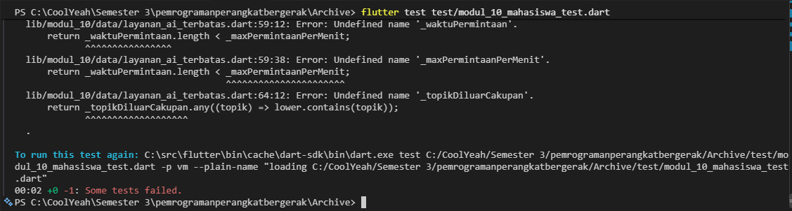
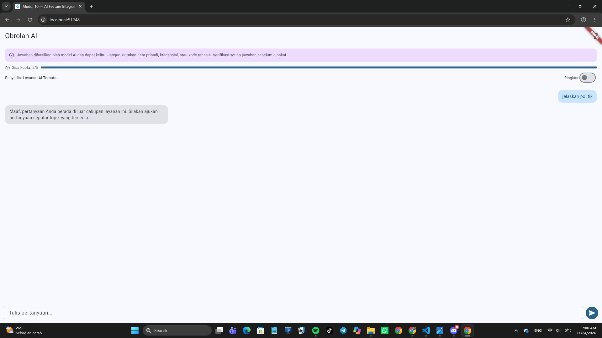

# Laporan Praktikum Modul 10: Integrasi Layanan AI

- **Nama**: Khairan Adiokta Arun Nugraha
- **NIM**: 362558302097
- **Kelas / Prodi**: 2C / Sarjana Terapan TRPL
- **Mata Kuliah**: Pemrograman Perangkat Bergerak (Semester 3)

---

## 1. Ringkasan Implementasi
integrasi fitur AI ke dalam Flutter dengan menerapkan prinsip Clean Architecture dan Dependency Injection. Fokus utamanya pada pembuatan implementasi `LayananAiTerbatas` yang mampu menangani respons secara bertahap, membatasi kuota permintaan, menolak pertanyaan di luar cakupan topik, serta menyaring dan menyamarkan data sensitif (seperti API key dan email) tanpa melanggar kontrak antarmuka `LayananAi`. modul ini juga mendemonstrasikan cara menghubungkan aplikasi Flutter ke model AI asli menggunakan 9router secara aman menggunakan lokal server agar API key tidak terekspos di sisi client.

## 2. Bukti Tangkapan Layar (Running App)
| Tes Lulus | Tes Gagal | UI |
|---|---|---|
|  |  |  |

